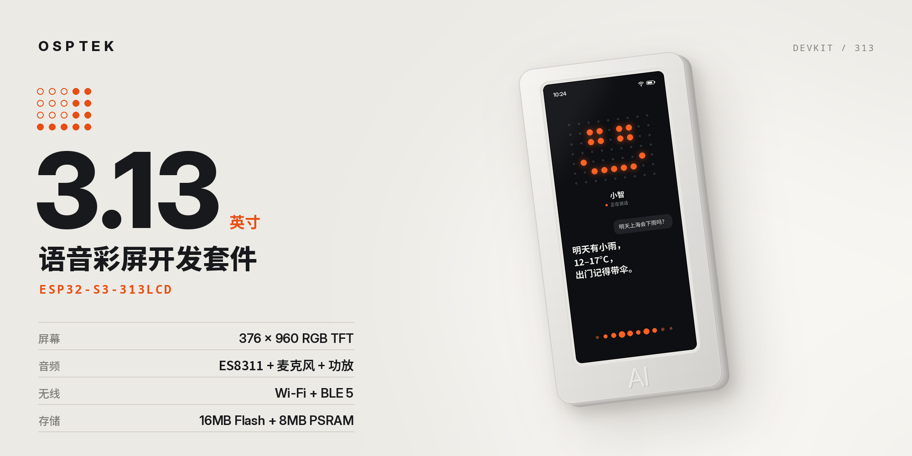
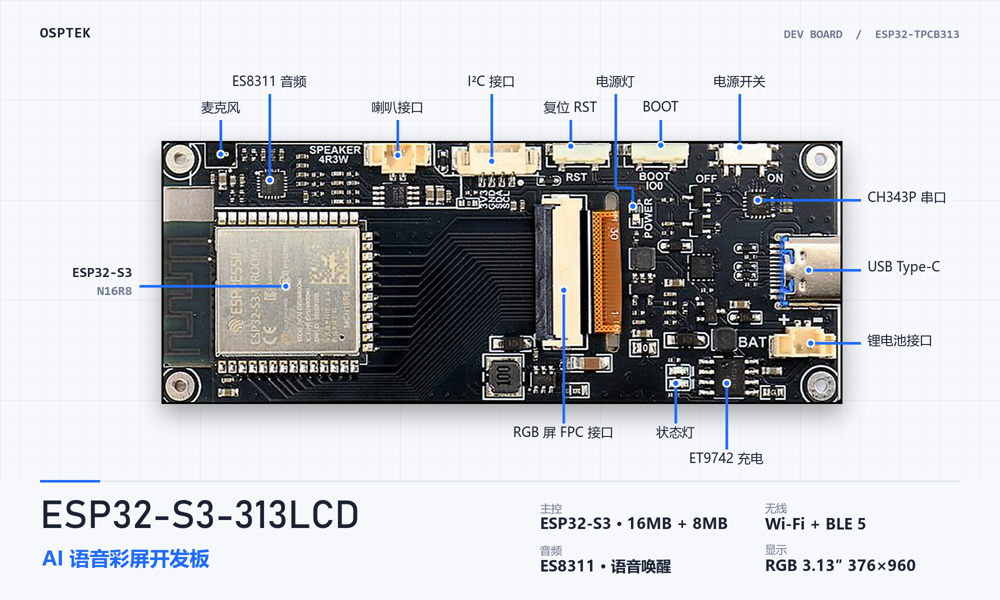

# ESP32-S3-313LCD 语音彩屏开发套件

OSPTEK 开发套件 · ESP32-S3 主控 · 3.13″ 376 × 960 RGB TFT 彩屏 · 语音识别 / 唤醒

<p align="center">
  
</p>

<p align="center">
  <b>简体中文</b> &nbsp;|&nbsp; <a href="README_EN.md">English</a>
</p>

## 简介

ESP32-S3-313LCD 是一款以 ESP32-S3-WROOM-1-N16R8 模组（2.4 GHz Wi-Fi + BLE 5）为主控的开发套件，集成 16 MB Flash 和 8 MB PSRAM，板载 3.13 英寸 376 × 960 分辨率 RGB 接口 TFT 彩屏（GC9503V 驱动），配合 ES8311 音频编解码芯片和板载麦克风，支持语音识别和近 / 远场语音唤醒。

本仓库面向二次开发，提供基于 ESP-IDF 的示例代码和硬件资料。

## 硬件规格

<p align="center">
  
</p>

| 项目 | 参数 |
| :--- | :--- |
| 主板 | ESP32-TPCB313 |
| 主控 | ESP32-S3-WROOM-1-N16R8（16 MB Flash，8 MB PSRAM） |
| 显示屏 | 3.13″ TFT，376 × 960，RGB 接口，GC9503V |
| 无线 | 2.4 GHz Wi-Fi，BLE 5 |
| 音频 | ES8311 编解码器（I2S + I2C），板载模拟麦克风，MX1.25 扬声器接口（带功放） |
| USB | Type-C（ESP32-S3 USB，供电 / 烧录 / 充电），CH343P USB 转串口（最高 6 Mbps） |
| 电池 | MX1.25 两针接口，单节 3.7 V 锂电池，ET9742 充电管理 |
| 扩展 | I²C 传感器接口 |
| 按键 | Reset、Boot（长按语音输入）、Power |
| 指示灯 | 绿色电源灯，红色充电状态灯 |
| 功耗 | 连接 Wi-Fi 亮屏约 170 mA，播放音乐峰值约 550 mA |

厂家使用指南（含原理图）见 [docs/ESP32-S3-313LCD_使用指南_2025.01.22.pdf](docs/ESP32-S3-313LCD_使用指南_2025.01.22.pdf)。

### 引脚分配

#### 音频 / I²C

| 功能 | GPIO |
| :--- | :--- |
| I2C SDA | 1 |
| I2C SCL | 2 |
| I2S DSDIN | 38 |
| I2S LRCK | 39 |
| I2S SDOUT | 40 |
| I2S SCLK | 41 |
| I2S MCLK | 42 |
| PA_CTRL（功放使能） | 45 |

#### LCD（RGB）

| 功能 | GPIO | 功能 | GPIO | 功能 | GPIO |
| :--- | :--- | :--- | :--- | :--- | :--- |
| VSYNC | 5 | R4 | 16 | B4 | 12 |
| HSYNC | 6 | R3 | 17 | B3 | 13 |
| PCLK | 7 | R2 | 18 | B2 | 14 |
| DE | 15 | R1 | 8 | B1 | 21 |
| BLK（背光） | 4 | R0 | 19 | B0 | 47 |
| | | G5 | 20 | | |
| | | G4 | 3 | | |
| | | G3 | 46 | | |
| | | G2 | 9 | | |
| | | G1 | 10 | | |
| | | G0 | 11 | | |

LCD 初始化使用模拟 SPI（与 RGB 数据线复用）：

| 功能 | GPIO |
| :--- | :--- |
| SPI MOSI | 16 |
| SPI CLK | 17 |
| SPI CS | 48 |

RGB 屏占用了大量引脚，可用 GPIO 非常紧张。

## 快速开始

### 开发环境

- ESP-IDF v5.3.1
- Visual Studio Code + ESP-IDF 插件（可选）

### 进入下载模式

- 自动：通过串口 DTR / RTS 控制 EN、IO0，烧录工具会自动进入下载模式。
- 手动：按住 Boot，按下并松开 RST，再松开 Boot。

### 硬件连接

1. （可选）将扬声器接到扬声器输出接口。
2. 用 USB 数据线连接电脑与开发套件（注意使用可传输数据的线）。
3. 打开电源开关，电源指示灯亮起。

> 如使用锂电池，请选用带保护电路的电池。

## AI 对话例程

本开发套件使用的 AI 对话基于虾哥开源的源码基础上改动而来，请尊重开源，不要倒卖源码，开源地址为：
https://github.com/78/xiaozhi-esp32

本开发套件的源码地址为：https://gitee.com/Kevincoooool/xiaozhi-esp32/tree/yuying_3.13_lcd

1. 编译烧录后重启，设备进入配网模式。
2. 手机连接 `Xiaozhi` 开头的热点，浏览器打开 `192.168.4.1`，填写 Wi-Fi 名称和密码。
3. 配网成功后在电脑浏览器打开 [xiaozhi.me](https://xiaozhi.me)，输入设备提示的验证码完成绑定。
4. 说「你好小智」唤醒，或按住 Boot 键说话。

## 仓库结构

```
.
├── examples/   # ESP-IDF 示例代码（待添加）
└── docs/       # 使用指南（含原理图）等文档
```

## 许可证

- 代码（`examples/`）：[Apache-2.0](LICENSE)
- 文档（`docs/`）：[CC BY-NC-SA 4.0](LICENSE-CC-BY-NC-SA-4.0)
- 第三方组件沿用其原有许可证
