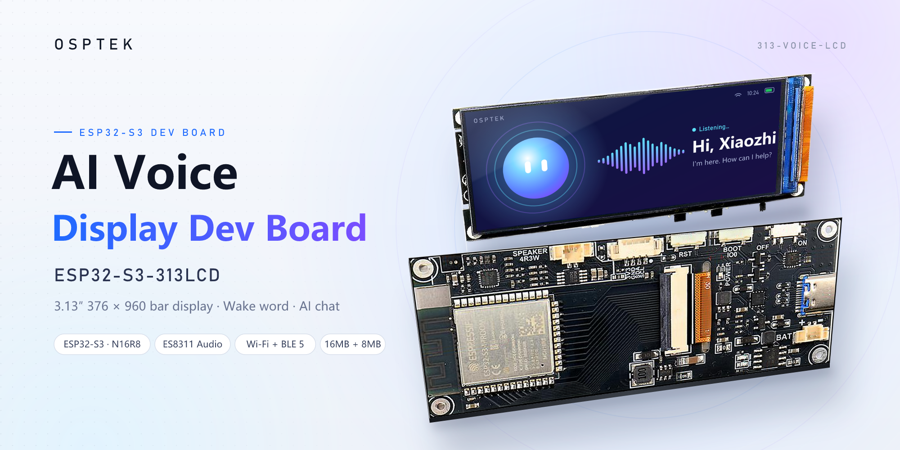
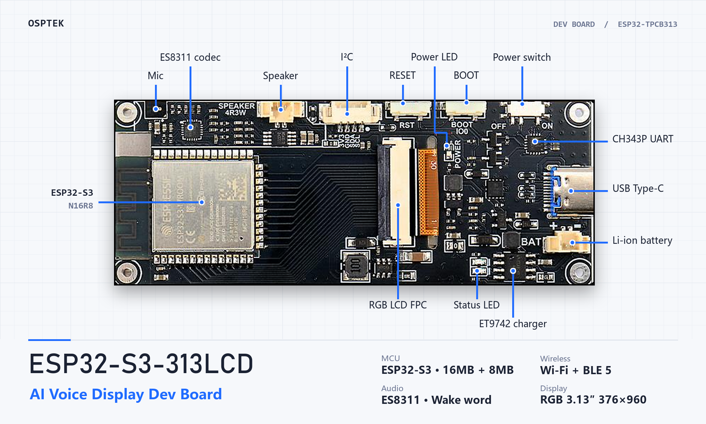

# ESP32-S3-313LCD AI Voice Display Dev Board

OSPTEK dev board · ESP32-S3 · 3.13″ 376 × 960 RGB TFT · Speech recognition / wake word

<p align="center">
  
</p>

<p align="center">
  <a href="README.md">简体中文</a> &nbsp;|&nbsp; <b>English</b>
</p>

## Overview

ESP32-S3-313LCD is a development board built around the ESP32-S3-WROOM-1-N16R8 module (2.4 GHz Wi-Fi + BLE 5) with 16 MB Flash and 8 MB PSRAM. It carries a 3.13-inch 376 × 960 RGB-interface TFT display (GC9503V driver), an ES8311 audio codec and an on-board microphone, supporting speech recognition and near / far-field wake word detection.

This repository is intended for development on the board and provides ESP-IDF examples and hardware documentation.

## Hardware

<p align="center">
  
</p>

| Item | Spec |
| :--- | :--- |
| Board | ESP32-TPCB313 |
| MCU | ESP32-S3-WROOM-1-N16R8 (16 MB Flash, 8 MB PSRAM) |
| Display | 3.13″ TFT, 376 × 960, RGB interface, GC9503V |
| Wireless | 2.4 GHz Wi-Fi, BLE 5 |
| Audio | ES8311 codec (I2S + I2C), on-board analog mic, MX1.25 speaker connector (with amplifier) |
| USB | Type-C (ESP32-S3 USB: power / flashing / charging), CH343P USB-UART (up to 6 Mbps) |
| Battery | MX1.25 2-pin connector, single-cell 3.7 V Li-ion, ET9742 charger |
| Expansion | I²C sensor connector |
| Buttons | Reset, Boot (hold to talk), Power |
| LEDs | Green power LED, red charge status LED |
| Power | ~170 mA with Wi-Fi and display on, ~550 mA peak when playing audio |

The vendor user guide (Chinese, with schematics) is at [docs/ESP32-S3-313LCD_使用指南_2025.01.22.pdf](docs/ESP32-S3-313LCD_使用指南_2025.01.22.pdf).

### Pin Assignment

#### Audio / I²C

| Function | GPIO |
| :--- | :--- |
| I2C SDA | 1 |
| I2C SCL | 2 |
| I2S DSDIN | 38 |
| I2S LRCK | 39 |
| I2S SDOUT | 40 |
| I2S SCLK | 41 |
| I2S MCLK | 42 |
| PA_CTRL (amplifier enable) | 45 |

#### LCD (RGB)

| Function | GPIO | Function | GPIO | Function | GPIO |
| :--- | :--- | :--- | :--- | :--- | :--- |
| VSYNC | 5 | R4 | 16 | B4 | 12 |
| HSYNC | 6 | R3 | 17 | B3 | 13 |
| PCLK | 7 | R2 | 18 | B2 | 14 |
| DE | 15 | R1 | 8 | B1 | 21 |
| BLK (backlight) | 4 | R0 | 19 | B0 | 47 |
| | | G5 | 20 | | |
| | | G4 | 3 | | |
| | | G3 | 46 | | |
| | | G2 | 9 | | |
| | | G1 | 10 | | |
| | | G0 | 11 | | |

The LCD is initialized over a bit-banged SPI that shares pins with the RGB data lines:

| Function | GPIO |
| :--- | :--- |
| SPI MOSI | 16 |
| SPI CLK | 17 |
| SPI CS | 48 |

The RGB display uses most of the pins, so free GPIOs are very limited.

## Getting Started

### Development Environment

- ESP-IDF v5.3.1
- Visual Studio Code + ESP-IDF extension (optional)

### Entering Download Mode

- Automatic: the flashing tool drives EN and IO0 through the serial DTR / RTS lines.
- Manual: hold Boot, press and release RST, then release Boot.

### Hardware Setup

1. (Optional) Connect a speaker to the speaker connector.
2. Connect the board to your computer with a USB data cable (charge-only cables won't work).
3. Turn on the power switch; the power LED lights up.

> If you use a Li-ion battery, make sure it has a built-in protection circuit.

## AI Chat Example

The AI chat on this board is modified from the open-source code by Xiage (虾哥). Please respect open source and do not resell the source code. The original open-source project:
https://github.com/78/xiaozhi-esp32

Source code for this board: https://gitee.com/Kevincoooool/xiaozhi-esp32/tree/yuying_3.13_lcd

1. After flashing, reboot the board; it enters Wi-Fi provisioning mode.
2. Connect your phone to the hotspot starting with `Xiaozhi`, open `192.168.4.1` in a browser and enter your Wi-Fi name and password.
3. Once connected, open [xiaozhi.me](https://xiaozhi.me) on your computer and enter the verification code shown on the device to bind it.
4. Say "你好小智" (Hi, Xiaozhi) to wake it up, or hold the Boot button and talk.

## Repository Layout

```
.
├── examples/   # ESP-IDF examples (coming soon)
└── docs/       # User guide (with schematics) and other docs
```

## License

- Code (`examples/`): [Apache-2.0](LICENSE)
- Documentation (`docs/`): [CC BY-NC-SA 4.0](LICENSE-CC-BY-NC-SA-4.0)
- Third-party components keep their original licenses
